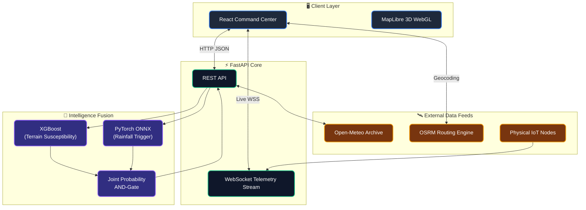

<div align="center">
  
  <h1 align="center">SlopeGuard 2.0</h1>
  <p align="center">
    <em>Military-Grade Geospatial AI for Real-Time Landslide Prediction</em>
  </p>
  
  <p align="center">
    <a href="https://reactjs.org/"></a>
    <a href="https://fastapi.tiangolo.com/"></a>
    <a href="https://pytorch.org/"></a>
  </p>

  <p align="center">
    <a href="#features">Features</a> • 
    <a href="#architecture">Architecture</a> • 
    <a href="#ml-engine">ML Engine</a> • 
    <a href="#setup-guide">Setup Guide</a>
  </p>
</div>

---

> [!IMPORTANT]
> **v2.0 Release:** SlopeGuard now features Global Open-Meteo Integration, Interactive DVR Historical Replays, and OSRM-powered Dynamic Evacuation Routing.

## 🌍 Overview
**SlopeGuard** is an advanced risk intelligence platform designed to predict and monitor landslide threats anywhere on Earth. It fuses live IoT telemetry, physical terrain geometry, and historical rainfall patterns to provide a unified, WebGL-powered command center.

Instead of static dashboards, SlopeGuard calculates **probabilistic failure modes** on the fly, dynamically generating evacuation routes, tracking critical infrastructure, and routing physical hardware sensors directly onto an interactive 3D-capable map.

---

## ✨ Dynamic Capabilities

| Feature | Description |
| :--- | :--- |
| 🌐 **Global API Search** | Powered by OSM Nominatim and Open-Meteo. Search for **any coordinate on Earth**, fetch its real 30-day precipitation history, and run it through the neural network instantly. |
| ⏪ **DVR Historical Replay** | Switch into historical simulator mode to replay catastrophic past events (e.g., *2024 Wayanad, 2013 Kedarnath*). The dashboard overrides live data to stream simulated 400mm+ monsoons and critical hardware failure telemetry. |
| 🚑 **Evacuation Routing** | Powered by the Open Source Routing Machine (OSRM). Instantly calculates emergency driving routes from the hazard zone to safe elevation, plotting the glowing route natively in MapLibre. |
| 🏥 **Infrastructure Engine** | Automatically calculates distance to nearby medical facilities and transit bridges, updating exposure levels and tracking status dynamically based on the AI risk score. |

---

<h2 id="architecture">🏗️ System Architecture</h2>

The architecture has been designed for extreme low-latency and high availability, splitting the physical terrain AI from the meteorological time-series AI.



---

<h2 id="ml-engine">🧠 The AI Pipeline</h2>
SlopeGuard does not rely on simple thresholds. It utilizes a scientifically-grounded **Joint Probability Fusion Engine**.

> [!NOTE]
> **Why Joint Probability?**
> A steep cliff is dangerous, but won't slide without a trigger. A heavy monsoon is dangerous, but won't cause a landslide on a flat plain. Both conditions must be met.

### 1. Terrain Susceptibility (XGBoost)
Evaluates the physical geometry of the mountain.
* **Features:** Slope Angle, Aspect (Direction), Curvature, Topographic Wetness Index (TWI).
* **Model:** Gradient Boosted Trees with Platt Scaling (Calibrated Classifier).
* **Output:** $P(Failure \mid Terrain)$

### 2. Meteorological Trigger (PyTorch LSTM)
Evaluates the sequence and intensity of recent weather.
* **Features:** 30-day sequential rainfall curves, 7-day antecedent moisture, 3-day peak intensity. Absolute volume normalization (500mm scale).
* **Model:** 2-layer Long Short-Term Memory (LSTM) network exported via ONNX.
* **Output:** $P(Failure \mid Rainfall)$

### 3. Joint Probability Fusion
We calculate the joint probability using a pure logical AND-gate to prevent false positives:

```math
Risk Score = P(Failure | Terrain) × P(Failure | Rainfall) × 100
```

---

<h2 id="setup-guide">🛠️ Local Development</h2>

### 1. Backend Engine
```bash
cd backend
python -m venv venv
source venv/bin/activate
pip install -r requirements.txt

# Start the FastAPI server
uvicorn main:app --reload --port 8000
```

### 2. ML Model Retraining
To regenerate the PyTorch ONNX weights and XGBoost Pickles:
```bash
cd ml
source ../backend/venv/bin/activate
# Run on single thread to prevent Mac multiprocessing deadlocks
OMP_NUM_THREADS=1 MKL_NUM_THREADS=1 python train.py
```

### 3. Command Center (Frontend)
```bash
cd frontend
npm install
npm run dev
```

---

<div align="center">
  <p><strong>Actively maintained and developed by:</strong></p>
  <a href="https://github.com/himanshu-rag"></a>
  <a href="mailto:sharmat3420@gmail.com"></a>
  <a href="mailto:parasnegi378@gmail.com"></a>
  <br/><br/>
  <i>Built to save lives. Deployed at the edge.</i>
</div>
