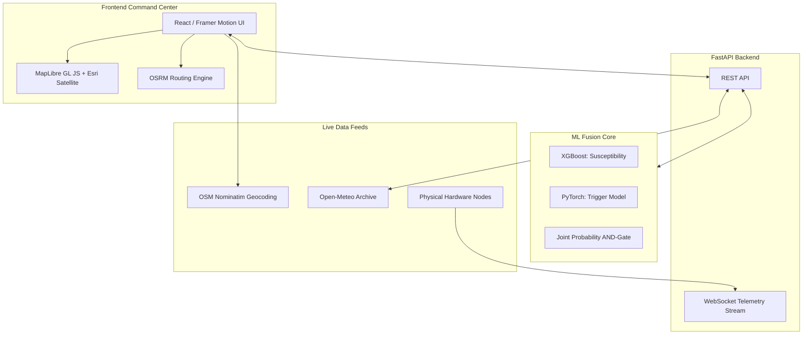

<div align="center">
  
  <h1 align="center">SlopeGuard</h1>
  <p align="center">
    <strong>Military-Grade Geospatial AI for Real-Time Landslide Prediction</strong>
  </p>
  <p align="center">
    <a href="#features">Features</a> • 
    <a href="#architecture">Architecture</a> • 
    <a href="#ml-engine">ML Engine</a> • 
    <a href="#setup-guide">Setup Guide</a> • 
    <a href="#collaborators">Team</a>
  </p>
</div>

<br/>

## 🌍 Overview
**SlopeGuard** is an advanced risk intelligence platform designed to predict and monitor landslide threats anywhere on Earth. It fuses live IoT telemetry, physical terrain geometry (XGBoost), and historical rainfall patterns (PyTorch LSTM) to provide a unified, WebGL-powered command center.

Instead of static dashboards, SlopeGuard calculates **probabilistic failure modes** on the fly, dynamically generating evacuation routes, tracking critical infrastructure, and routing physical hardware sensors directly onto an interactive 3D-capable map.

---

## ✨ Latest Updates (v2.0)
* 🌐 **Global API Search:** Powered by OpenStreetMap Nominatim and Open-Meteo Archive. Search for **any coordinate on Earth**, fetch its real 30-day precipitation history, and run it through the neural network instantly.
* ⏪ **DVR Historical Replay:** Switch into historical simulator mode to replay catastrophic past events (e.g., 2024 Wayanad, 2013 Kedarnath). The dashboard overrides live data to stream simulated 400mm+ monsoons and critical hardware failure telemetry.
* 🚑 **Dynamic Evacuation Routing:** Powered by the Open Source Routing Machine (OSRM). Instantly calculates emergency driving routes from the hazard zone to safe elevation, plotting the glowing route natively in MapLibre.
* 🏥 **Infrastructure Vulnerability Engine:** Automatically calculates distance to nearby medical facilities and transit bridges, updating exposure levels and tracking status dynamically based on the AI risk score.

---

## 🏗️ System Architecture

SlopeGuard operates on a high-performance modern stack divided into three primary layers:



---

## 🧠 The AI Pipeline
SlopeGuard does not rely on simple thresholds. It utilizes a scientifically-grounded **Joint Probability Fusion Engine**.

### 1. Terrain Susceptibility (XGBoost)
Evaluates the physical geometry of the mountain.
* **Features:** Slope Angle, Aspect (Direction), Curvature, Topographic Wetness Index (TWI).
* **Model:** Gradient Boosted Trees with Platt Scaling (Calibrated Classifier).
* **Output:** $P(Failure \mid Terrain)$

### 2. Meteorological Trigger (PyTorch LSTM)
Evaluates the sequence and intensity of recent weather.
* **Features:** 30-day sequential rainfall curves, 7-day antecedent moisture, 3-day peak intensity. Absolute volume normalization (500mm scale).
* **Model:** 2-layer Long Short-Term Memory (LSTM) network exported via ONNX.
* **Output:** $P(Failure \mid Rainfall)$

### 3. Joint Probability Fusion
Both conditions must be met for a catastrophic event. We calculate the joint probability using a pure logical AND-gate to prevent false positives:
`Risk Score = P(Failure | Terrain) × P(Failure | Rainfall) × 100`

---

## 🛠️ Local Development

### 1. Backend Engine
```bash
cd backend
python -m venv venv
source venv/bin/activate
pip install -r requirements.txt

# Start the FastAPI server
uvicorn main:app --reload --port 8000
```

### 2. ML Model Retraining
To regenerate the PyTorch ONNX weights and XGBoost Pickles:
```bash
cd ml
source ../backend/venv/bin/activate
# Run on single thread to prevent Mac multiprocessing deadlocks
OMP_NUM_THREADS=1 MKL_NUM_THREADS=1 python train.py
```

### 3. Command Center (Frontend)
```bash
cd frontend
npm install
npm run dev
```

---

## 🤝 Collaborators
This project is actively maintained and developed by:
* [@himanshu-rag](https://github.com/himanshu-rag)
* [sharmat3420@gmail.com](mailto:sharmat3420@gmail.com)
* [parasnegi378@gmail.com](mailto:parasnegi378@gmail.com)

<div align="center">
  <br/>
  <i>Built to save lives. Deployed at the edge.</i>
</div>
